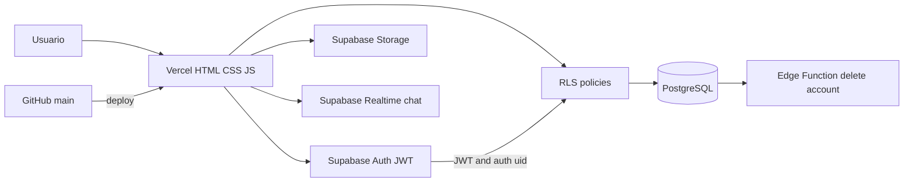

# MGMOTORS

Projeto prático de portfólio: marketplace web de compra e venda de veículos, construído com HTML, CSS e JavaScript no frontend e Supabase no backend.

> Projeto educacional de portfólio. Dados, usuários, anúncios e mensagens apresentados na demo são demonstrativos; o sistema não representa uma operação comercial real.

[](https://github.com/murilotecoteco/MGMOTORS)
[](https://mgmotorss.vercel.app/MG-INICIO/inicio.html)

[Live Demo](https://mgmotorss.vercel.app/MG-INICIO/inicio.html) · [Código-fonte](https://github.com/murilotecoteco/MGMOTORS)

## Visão geral

O MGMOTORS conecta compradores e vendedores em uma experiência de marketplace com anúncios, filtros, perfis, favoritos, mensagens e moderação.

O projeto foi construído para praticar:

- autenticação com Supabase Auth e JWT;
- PostgreSQL com Row Level Security (RLS);
- fotos em Supabase Storage;
- chat em tempo real com Supabase Realtime;
- Edge Function para operação privilegiada de exclusão de conta;
- frontend estático e funções serverless no Vercel.

## Arquitetura



### Fluxos principais

1. **Autenticação:** o frontend envia as credenciais ao Supabase Auth, que emite um JWT.
2. **Acesso aos dados:** as requisições carregam o JWT; as policies RLS usam `auth.uid()` para limitar leitura e escrita.
3. **Persistência:** anúncios, perfis e mensagens ficam no PostgreSQL; arquivos ficam no Storage.
4. **Operação privilegiada:** a exclusão completa de conta passa pela Edge Function `delete-account`.
5. **Entrega:** pushes no branch `main` podem acionar o deploy no Vercel.

## Funcionalidades

- Marketplace com busca, filtros e ordenação
- Publicação e edição de anúncios com múltiplas fotos
- Perfis, seguidores, curtidas e avaliações
- Chat em tempo real com envio de fotos
- Autenticação, recuperação de senha e aceite legal
- Denúncias, moderação e painel administrativo
- Tema claro/escuro e layout responsivo
- Headers HTTP de segurança, SEO e acessibilidade

## Stack

| Camada | Tecnologia |
| --- | --- |
| Frontend | HTML5, CSS3 e JavaScript ES2022 |
| Backend/Auth | Supabase Auth, Edge Functions e Realtime |
| Banco | PostgreSQL |
| Segurança de dados | RLS |
| Arquivos | Supabase Storage |
| Deploy | Vercel |
| Ícones | Lucide Icons |

## Resultado e aprendizados

- **Resultado:** fluxos de anúncios, filtros, perfis, favoritos, mensagens e moderação organizados em uma aplicação publicada.
- **Aprendizado:** integração entre autenticação, PostgreSQL, RLS, Storage privado, Realtime e uma operação privilegiada em Edge Function.

## Segurança e limitações

- As políticas RLS limitam o acesso aos dados por usuário e função.
- Fotos privadas usam políticas por participante e URLs assinadas.
- A chave pública do Supabase não substitui as políticas RLS.
- A Edge Function mantém a operação privilegiada fora do navegador.
- O projeto usa o plano gratuito do Supabase; o banco pode pausar após inatividade e possui limites de quota.
- Testes destrutivos de RLS devem usar staging e contas descartáveis.
- O projeto é educacional/portfolio e não deve ser tratado como serviço de produção sem monitoramento, backups, rotação de segredos e controles operacionais adicionais.

## Como executar

### Pré-requisitos

- Node.js 18+
- Projeto Supabase configurado
- Vercel CLI, para testar as funções serverless localmente

### Instalação

```bash
git clone https://github.com/murilotecoteco/MGMOTORS.git
cd MGMOTORS
npm install -g vercel
vercel dev
```

O site local ficará disponível em `http://localhost:3000`.

### Variáveis de ambiente

Configure no ambiente local ou no Vercel:

```env
SUPABASE_URL=
SUPABASE_KEY=
```

A chave usada pelo frontend é pública; a proteção dos dados depende das policies RLS.

## Estrutura principal

```text
MGMOTORS/
├── MG-INICIO/              # Landing page
├── MG-MARKETPLACE/         # Anúncios e filtros
├── MG-MENSAGENS/           # Chat
├── MG-CONTA/               # Perfil e conta
├── MG-LOGIN/               # Autenticação
├── MG-DEV/                 # Painel administrativo
├── api/                    # Funções serverless
├── supabase/migrations/    # Schema e RLS
├── supabase/functions/     # Edge Functions
├── vercel.json             # Headers de segurança
└── index.html
```

## Roadmap

- [x] Marketplace, filtros e ordenação
- [x] Autenticação e recuperação de senha
- [x] Anúncios com fotos
- [x] Chat em tempo real
- [x] RLS, Storage e Realtime
- [x] Painel administrativo
- [ ] Simulador de financiamento
- [ ] Comparador de veículos
- [ ] Exportação em PDF

## Licença

Projeto desenvolvido para fins educacionais e de portfólio. Nenhuma licença foi aplicada.
